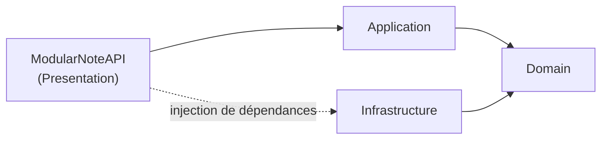

# ModularNote - API

API REST de ModularNote, développée en ASP.NET (.NET 10).

## Architecture

Clean architecture : les dépendances pointent vers le `Domain`, qui ne dépend de rien.



| Projet | Rôle |
|---|---|
| `ModularNoteAPI` | Point d'entrée HTTP (controllers, configuration) |
| `Application` | Cas d'utilisation de l'application |
| `Domain` | Cœur métier |
| `Infrastructure` | Accès aux données et services externes |
| `ModularNoteUnitTest` | Tests unitaires |
| `ModularNoteIntegrationTest` | Tests d'intégration |

## Commandes

Depuis `API/ModularNoteAPI` :

```bash
dotnet build ModularNoteAPI.slnx
dotnet test ModularNoteAPI.slnx
dotnet run --project ModularNoteAPI
```
