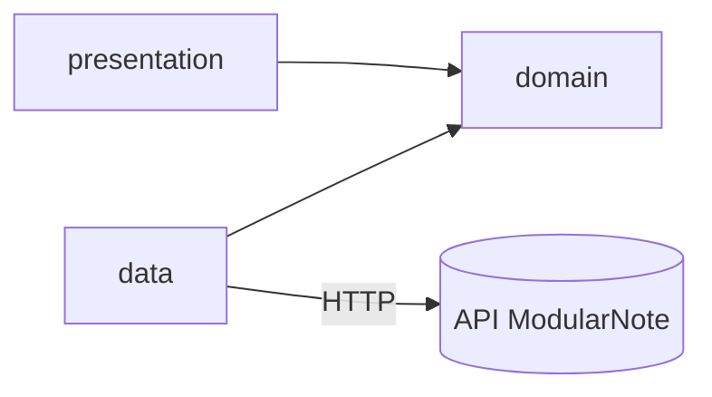

# ModularNote - Front

Client web de ModularNote, développé en React + TypeScript avec Vite.

## Architecture

Clean architecture côté web : les dépendances pointent vers le `domain`, qui ne dépend de rien.



| Dossier (`ModularNote/src/`) | Rôle |
|---|---|
| `presentation/` | Interface utilisateur |
| `domain/` | Cœur métier |
| `data/` | Accès aux données (appels à l'API) |
| `core/` | Éléments partagés |

## Commandes

Depuis `FRONT/ModularNote` :

```bash
npm install
npm run dev      # serveur de développement
npm run lint
npm run build
```
