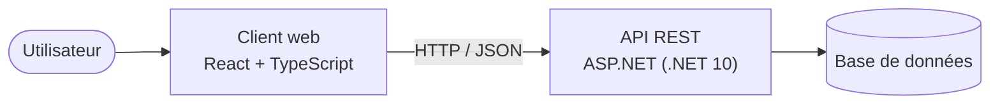

# ModularNote

Application web pour noter ses idées et les visualiser sur un canvas, reliées entre elles.

> Projet en cours de développement.

## Architecture



| Dossier | Contenu |
|---|---|
| [`API/`](API/README.md) | API REST en ASP.NET, organisée en clean architecture |
| [`FRONT/`](FRONT/README.md) | Client web React, organisé en clean architecture |

## Démarrage rapide

Prérequis : [.NET 10 SDK](https://dotnet.microsoft.com/download) et [Node.js](https://nodejs.org/) (LTS).

```bash
# API
cd API/ModularNoteAPI
dotnet run --project ModularNoteAPI

# Front (dans un autre terminal)
cd FRONT/ModularNote
npm install
npm run dev
```
